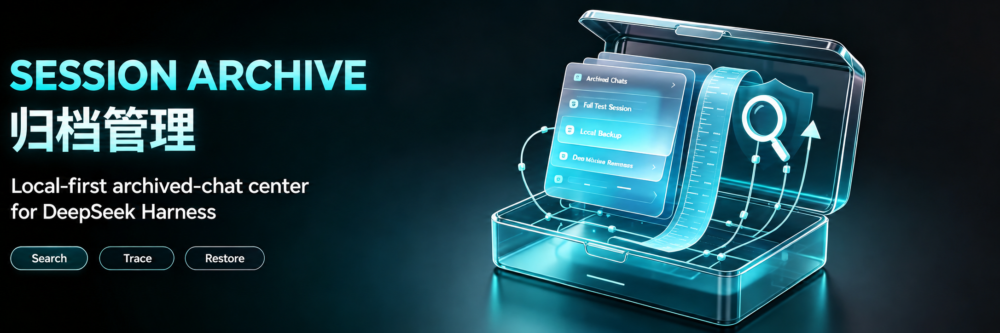

<p align="center">
  
</p>

<div align="center">

<h1>归档管理</h1>

<p><strong>找回 DSH 历史对话，搜索、管理归档并保存 ZIP 备份。</strong></p>
<p><code>dsh-archived-chats</code></p>

<p>
  <a href="https://www.npmjs.com/package/dsh-archived-chats"></a>
  <a href="https://www.npmjs.com/package/dsh-archived-chats"></a>
  <a href="https://github.com/Ultronen/dsh-archived-chats/actions/workflows/ci.yml"></a>
  <a href="https://github.com/Ultronen/dsh-archived-chats/actions/workflows/ci.yml"></a>
</p>
<p>
  <a href="https://github.com/Ultronen/dsh-archived-chats/blob/main/LICENSE"></a>
  <a href="https://awesome-dsh-plugin.com/p/Ultronen/dsh-archived-chats/"></a>
  <a href="https://github.com/Ultronen/dsh-archived-chats/stargazers"></a>
</p>

<p><a href="README.md">English</a> · 简体中文</p>
<p><a href="https://awesome-dsh-plugin.com/p/Ultronen/dsh-archived-chats/">插件市场</a> · <a href="https://www.npmjs.com/package/dsh-archived-chats">npm</a> · <a href="https://github.com/Ultronen/dsh-archived-chats/releases">版本发布</a> · <a href="https://github.com/Ultronen/dsh-archived-chats/discussions">问题交流</a> · <a href="https://github.com/Ultronen/dsh-archived-chats/security/advisories/new">私密报告漏洞</a></p>

</div>

归档管理为 DeepSeek Harness 补充会话查找、整理和备份能力。搜索过去的解决方案，直接预览内容，按工作区归档，或在删除前保存一份 ZIP 备份。

- **找回内容：** 搜索标题、正文、工具结果、标签和备注，点击命中片段查看上下文。
- **整理会话：** 管理已归档和未归档聊天，支持工作区分组、未分组、批量操作及标签备注。
- **保存备份：** 导出 JSON + Markdown ZIP，导入前预览并跳过已有会话，避免覆盖。

> 本文对应 1.6.0。此版本停止新增回收和自动清理，旧数据的处理方式见[从旧版升级](#从旧版升级)。

## 安装与打开

在 DSH 插件市场搜索 `dsh-archived-chats`，核对作者 **Ultronen** 后安装。按宿主提示重启，打开 **设置 → 归档管理**（英文为 Archive Management）。

也可使用命令行。`web` 是示例 profile，请替换为实际运行 DSH 的 profile，更新和卸载也使用同一个：

```sh
dsh plugin --profile web add dsh-archived-chats@latest
```

若提示 `ERR_PNPM_ADDING_TO_ROOT`，在 `add` 后加 `-w`。更新命令：

```sh
dsh plugin --profile web update dsh-archived-chats
```

## 第一次使用

1. 打开 **未归档**，点击聊天标题预览，选择需要保留的聊天并归档。空白新聊天不列入可归档范围；正在执行的聊天需要先确认「停止并归档」。
2. 在 **已归档** 搜索关键词，点击标题或命中片段查看内容；在预览中编辑标签和备注。
3. 点击 **选择**，勾选聊天后 **导出选中**；窄屏下该操作位于三点菜单。到浏览器下载中确认 ZIP 已保存。
4. 需要继续聊天时 **取消归档**。删除会话前先确认备份是否需要保留；删除为不可撤销的永久删除。

## 页面与能力

| 页面 | 用途 |
| --- | --- |
| 已归档 | 搜索、筛选、预览、标签备注、导入导出、取消归档和确认永久删除。 |
| 未归档 | 获取工作区及未分组中的普通聊天，预览并按单条、工作区或全局归档。 |
| 来源与分支 | 查看与已归档聊天相关的来源、分叉和子代理关系；只读，不改变会话。 |
| 关于 | 自动检查更新、运行环境与本地开发版识别、复制安装信息、宿主支持时一键更新，以及手动「检查残留会话」。 |
| 回收站（有旧记录时） | 处理旧记录：恢复到已归档、导出保护快照或确认永久删除；空目录隐藏。 |

正文搜索从两个字符开始，分批扫描当前筛选范围，展示进度、命中和失败数量；支持停止和重试。未归档搜索标题或会话 ID。完整范围、长日志限制及操作说明见[用户指南](docs/USER_GUIDE.zh-CN.md)。

## 归档、删除与维护

**归档用于整理，删除用于永久移除。** 归档和取消归档使用 Host 的官方操作。行内垃圾桶、选中删除、工作区全部删除和全局全部删除均需确认；工作区删除不会删除项目目录。搜索和筛选不会缩小工作区或全局操作范围。

**残留检查是手动维护工具。** 从 **关于 → 维护工具 → 检查残留会话** 打开，仅检查有明确父来源且父会话已不存在的子代理会话。可先预览或导出，再勾选确认永久删除；执行时重新核对范围。未分组、独立分叉、普通未归档和空白聊天不作为该工具的清理目标。进入页面不会自动扫描或清理。

## 备份与数据边界

| 格式 | 内容 | 使用方式 |
| --- | --- | --- |
| 会话备份 ZIP | JSON、Markdown、标签备注及附件引用；不包含附件文件，不自动打包后代会话。 | 通过「导入备份」预览后导入；已有 ID 跳过。 |
| 旧回收保护快照 ZIP | 旧记录、已验证的会话载荷及图片附件；单条上限 64 MiB。 | 用于保存旧数据，不能通过普通会话导入器导入。 |

导出成功前会按导入使用的同一格式和预算完成验证。此保证针对普通会话备份；保护快照是独立格式。浏览器提示开始下载不代表文件已保存，需自行核对下载结果。

- 数据保存在运行 DSH 的主机 `$DSH_HOME/plugin-data/archived-chats/`，默认位于 `~/.dsh/`；插件不上传或云同步聊天。
- 永久删除清理会话及插件关联数据，不承诺擦除 Host 全局附件、缓存或外部备份。失败保留可重试任务。
- 没有工作目录的聊天会留在已归档；仅缺少工作区时可显示为未分组。
- 旧回收站清空仅处理确认时展示的精确回收记录实例；目标变化时拒绝扩大删除范围。

## 从旧版升级

1.6.0 不再提供新增「移入回收站」，移除「空间与策略」入口，并停用自动到期清理和启动快照清扫。

**已有数据不会因为移除入口而自动迁移或删除。** 旧回收记录、快照和策略文件保留。只要存在回收记录，仍显示回收站；目录读取失败时保留错误与重试入口，不能当作空目录隐藏。旧策略不执行，未完成的永久删除需明确重试。

恢复优先使用仍完好的原会话，成功后回到已归档。原会话丢失时，快照回退依赖 Host 能力；不支持或校验失败会保留记录并报错，不伪报成功。可先导出保护快照保存数据。不要通过手动删除插件数据目录来清空回收站。

重新安装旧版本可能重新启用其原有清理规则；降级前应保留完整数据备份，并确认待删除任务和数据格式兼容。

## 兼容性

声明范围为 DSH `>=0.1.0-rc.7`，具体能力仍取决于 Host。原生测试使用锁定的 `0.1.7-rc.2` 与 `0.2.1-rc.2` 后端，发布 CI 覆盖 macOS、Windows 和 Linux。

归档、取消归档、列表读取以官方能力为基础。永久删除由插件协调会话生命周期和存储位置完成，并非调用一个官方统一删除接口；ZIP 导入和旧快照恢复的写入能力要求也不同。详见[兼容性与限制](docs/USER_GUIDE.zh-CN.md#兼容性与限制)。

## 界面截图

以下截图来自 1.6.0，使用虚构示例会话。旧回收站仅在存在旧记录时显示；[截图清单](screenshots.json)保持以下顺序。

<details>
<summary>查看界面截图</summary>

1. [已归档](assets/screenshots/preview-01.png)
2. [全文搜索与选中操作](assets/screenshots/preview-02.png)
3. [未归档与工作区归档](assets/screenshots/preview-03.png)
4. [会话预览](assets/screenshots/preview-04.png)
5. [旧回收站](assets/screenshots/preview-05.png)
6. [恢复确认](assets/screenshots/preview-06.png)
7. [关于与手动维护](assets/screenshots/preview-07.png)
8. [来源与分支](assets/screenshots/preview-08.png)

</details>

## 文档与反馈

[用户指南](docs/USER_GUIDE.zh-CN.md) · [架构说明](docs/ARCHITECTURE.md) · [更新日志](CHANGELOG.md) · [支持](SUPPORT.md) · [贡献指南](CONTRIBUTING.md)

使用问题和建议欢迎前往 [Discussions](https://github.com/Ultronen/dsh-archived-chats/discussions)；缺陷请附插件与 DSH 版本、最小复现步骤和脱敏错误。安全问题请[私密报告](SECURITY.md)。若帮助你找回了旧方案，欢迎[给项目一个 Star](https://github.com/Ultronen/dsh-archived-chats)。

## 开发与验证

```sh
npm test
npm ci --prefix test/fixtures/native-host --ignore-scripts --include=optional
node scripts/run-native-integration.mjs
npm ci --prefix test/fixtures/native-host-0.2.1 --ignore-scripts --include=optional
node scripts/run-native-integration.mjs --fixture-root test/fixtures/native-host-0.2.1
npm pack --dry-run --json
```

原生测试使用隔离临时数据，每套 8 项均要求执行且不能跳过。提交贡献前请完整阅读[贡献指南](CONTRIBUTING.md)。

## 卸载

```sh
dsh plugin --profile web remove dsh-archived-chats
```

卸载插件包保留插件数据，不执行永久删除。详见[本地数据与卸载](docs/USER_GUIDE.zh-CN.md#本地数据与卸载)。

[MIT License](LICENSE)
